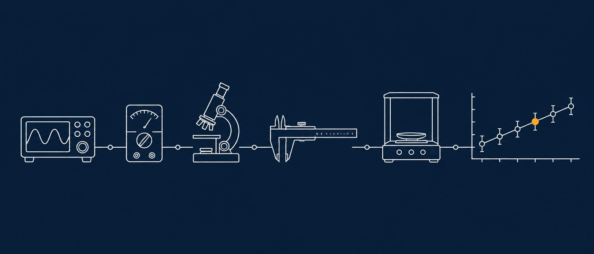

# Aghasalim Mustafazada

Third year AI student at Howest, Belgium, and co-founder and CTO of
[SIBA](https://siba.az), a small company in Baku that builds AI assistants in
Azerbaijani. I work on language models and on how to evaluate them: retrieval,
groundedness, benchmarks and data leakage. I like rerunning my own results
before I believe them, because a lot of things only work on the benchmark.

Open to remote AI engineering work.

## SIBA

- [chat.siba.az](https://chat.siba.az): an assistant that answers in
  Azerbaijani, English and Russian, in text and voice.
- [SIBA Meristem Native 0.5B](https://huggingface.co/aghasalim/siba-meristem-native-0.5b-base):
  an Azerbaijani language model trained from scratch on 5.94 billion tokens,
  with our own tokenizer (539 M parameters, Apache 2.0). It is a base model and
  a baseline: it continues text, it does not follow instructions.
- [azbench](https://github.com/aghasalim/azbench): an open Azerbaijani
  benchmark of 2,148 reading and exam questions, with a public leaderboard at
  [siba.az/azbench](https://siba.az/azbench).
- An agent on WhatsApp and Telegram, built and delivered for Zakher Travel, a
  tour operator in Baku. It answers partner agencies from the operator's live
  rates and hands over to a manager when data is missing.

## Selected work

Language models and retrieval

- [eu-ai-act-rag](https://github.com/aghasalim/eu-ai-act-rag): question
  answering over the EU AI Act, with retrieval, faithfulness and hallucination
  measured on 45 hand-written questions.
- [groundedness](https://github.com/aghasalim/groundedness) and
  [groundcheck-mcp](https://github.com/aghasalim/groundcheck-mcp): checks
  whether a model's claims are supported by its sources.
- [lora-forgetting](https://github.com/aghasalim/lora-forgetting): LoRA
  fine-tuning of a small LLM, with the catastrophic-forgetting check reported
  next to the task score.

Evaluation

- [leak-graph](https://github.com/aghasalim/leak-graph),
  [splitcheck](https://github.com/aghasalim/splitcheck) and
  [drift-harm](https://github.com/aghasalim/drift-harm): tools that measure
  leakage and drift instead of assuming them.
- [ieee-fraud-ml](https://github.com/aghasalim/ieee-fraud-ml): IEEE-CIS fraud
  detection with leak-free validation, 0.9086 on the private leaderboard.

Systems

- [smart-ivc-cage-platform](https://github.com/aghasalim/smart-ivc-cage-platform):
  FastAPI, React, Arduino and Raspberry Pi platform for an instrumented lab
  cage.
- [mlops-fraud-pipeline](https://github.com/aghasalim/mlops-fraud-pipeline): a
  model behind FastAPI with CI gating and drift monitoring.
- [ai-systems-from-scratch](https://github.com/aghasalim/ai-systems-from-scratch):
  index of eight pieces of modern AI rebuilt from the papers.

## Tools

Python for almost everything: PyTorch, scikit-learn, LightGBM, Transformers,
SHAP, FastAPI, Streamlit, Docker, GitHub Actions, PostgreSQL. TypeScript with
React and C++ on Arduino in the cage platform.

Most repositories have a `verify/` folder that recomputes the published numbers
in other languages (C, Go, Rust, R, JavaScript, Ruby). Those are small
independent checks. They are not languages I work in every day.

## Other

Papers on SSRN, 2026:

- [A Multilingual Groundedness Detector that Runs on a Raspberry Pi](https://doi.org/10.2139/ssrn.7497398), with Teymur Eyvazov
- [Retrieval over an Amended Law](https://papers.ssrn.com/sol3/papers.cfm?abstract_id=7590363), on the EU AI Act, with Murad Eyvazov
- [Evaluating a From-Scratch PatchCore on MVTec AD](https://papers.ssrn.com/sol3/papers.cfm?abstract_id=7590958), with Murad Eyvazov

Gold medal at the International STEM Olympiad in mathematics, 2022. Scored
0.9086 on the IEEE-CIS private leaderboard on
[Kaggle](https://www.kaggle.com/aghasalimmustafazada).

## Contact

salim.mustafazada@student.howest.be

[Website](https://aghasalim.com) ·
[LinkedIn](https://linkedin.com/in/mustafazada) ·
[Kaggle](https://www.kaggle.com/aghasalimmustafazada) ·
[ORCID](https://orcid.org/0009-0001-8746-4582)
